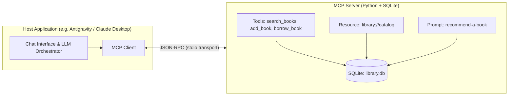

# Book Library MCP Server (mcp-intern-sasikala)

A production-grade, beginner-friendly **Model Context Protocol (MCP)** server built in Python using SQLite. This server exposes a local book library to MCP-compatible AI hosts, providing real-time book searching, catalog management, and borrowing operations through structured tools, resources, and reusable prompts.

---

## Table of Contents

1. [Overview](#overview)
2. [MCP Architecture (Host, Client, Server)](#mcp-architecture-host-client-server)
3. [Features & Capabilities](#features--capabilities)
   - [MCP Tools](#mcp-tools)
   - [MCP Resource](#mcp-resource)
   - [MCP Prompt](#mcp-prompt)
4. [Technology Stack](#technology-stack)
5. [Prerequisites](#prerequisites)
6. [Windows Installation & Setup](#windows-installation--setup)
7. [Running the MCP Server](#running-the-mcp-server)
8. [Testing with MCP Inspector](#testing-with-mcp-inspector)
9. [Connecting to AI Applications](#connecting-to-ai-applications)
   - [Option A: Google Antigravity](#option-a-google-antigravity)
   - [Option B: Claude Desktop](#option-b-claude-desktop)
   - [Option C: VS Code (Roo Code / Cline / Copilot)](#option-c-vs-code-roo-code--cline--copilot)
10. [Example Questions for the AI](#example-questions-for-the-ai)
11. [Running Automated Tests](#running-automated-tests)
12. [Project Structure](#project-structure)
13. [Security & Input Validation](#security--input-validation)
14. [Project Limitations](#project-limitations)
15. [Git & GitHub Setup](#git--github-setup)
16. [Five-Minute Internship Demo Script](#five-minute-internship-demo-script)

---

## Overview

The **Book Library MCP Server** bridges the gap between Large Language Models (LLMs) and local database storage. Instead of hallucinating titles or relying on static training data, the AI can:
- Query real-time library inventory in an SQLite database.
- Insert newly acquired books with duplicate prevention.
- Check out / borrow books with instant state transitions.
- Read complete catalogue snapshots via protocol resources.
- Use grounded recommendation prompts that recommend only real, available books.

---

## MCP Architecture (Host, Client, Server)

The Model Context Protocol separates responsibilities across three key layers:



### Explaining Host, Client, and Server in Simple Words:
1. **The Host**: The user-facing AI application (like Antigravity or Claude Desktop) that manages the chat window and talks to the Large Language Model.
2. **The Client**: The internal connector inside the Host that negotiates capabilities, handles the protocol format, and routes requests to external servers.
3. **The Server**: Our lightweight Python program (`server.py`) that securely accesses local data (SQLite) and provides tools, resources, and prompts back to the Client.

---

## Features & Capabilities

### MCP Tools

| Tool Name | Description | Parameters | Validation / Safety |
| :--- | :--- | :--- | :--- |
| `search_books` | Searches books by title or author keywords. Returns matching IDs, titles, authors, and availability. | `query` (string) | Trims whitespace, handles empty or blank inputs gracefully, returns helpful suggestions when no matches are found. |
| `add_book` | Adds a new book to the SQLite database. | `title` (string), `author` (string) | Rejects blank or empty values, trims inputs, checks case-insensitive duplicates to avoid accidental duplicates. |
| `borrow_book` | Borrows an available book by its ID. | `book_id` (integer) | Enforces positive integer IDs, verifies existence in database, prevents borrowing already checked-out books. |

### MCP Resource

- **URI**: `library://catalog`
- **Description**: Returns the full library book catalogue formatted with book IDs, availability status, titles, and authors directly from the SQLite database.
- **Purpose**: Gives the AI host a full context document without needing repeated tool calls.

### MCP Prompt

- **Name**: `recommend-a-book`
- **Argument**: `topic_or_genre` (optional, default: `"general reading"`)
- **Description**: Generates a grounded recommendation prompt containing the live library catalog.
- **Safety**: Strictly instructs the AI to recommend only books that exist in the local database and to prioritize available titles over currently borrowed ones.

---

## Technology Stack

- **Language**: Python 3.10+ (standard, free, open-source)
- **Protocol SDK**: Official `mcp[cli]` (Model Context Protocol Python SDK)
- **Database**: SQLite3 (built into Python standard library, zero external server dependencies)
- **Testing**: `pytest` for automated test suites
- **Transport**: Standard I/O (`stdio`), the standard low-overhead transport for local desktop MCP integrations

---

## Prerequisites

1. **Windows 10 / 11** with PowerShell.
2. **Python 3.10 or later** installed (verify with `py --version` or `python --version`).
3. **Node.js / npx** (Optional: only needed if running the standalone MCP Inspector web UI via `npx @modelcontextprotocol/inspector`).
4. **Git** for version control.

---

## Windows Installation & Setup

Open **Windows PowerShell** and navigate to your project directory:

```powershell
# 1. Navigate to the project root folder
cd c:\Users\acer\OneDrive\Documents\fastapi\mcp-server

# 2. Create a virtual environment using Python 3.10
py -3.10 -m venv .venv

# 3. Activate the virtual environment
.venv\Scripts\Activate.ps1

# (If PowerShell blocks script activation, run:
#  Set-ExecutionPolicy -ExecutionPolicy RemoteSigned -Scope Process)

# 4. Install dependencies
pip install -r requirements.txt
```

---

## Running the MCP Server

The server communicates via standard input/output (`stdio`), which is designed to be spawned by an MCP host or client:

```powershell
# Start the server directly in stdio mode:
.venv\Scripts\python.exe server.py
```

When started, it automatically creates `library.db` if it does not exist and seeds 5 initial sample books.

---

## Testing with MCP Inspector

The official MCP Inspector allows you to inspect tools, call functions, read resources, and test prompts interactively in a browser.

### Option 1: Using the Official MCP CLI (Recommended)

The installed `mcp` CLI includes built-in inspector support:

```powershell
.venv\Scripts\mcp.exe dev server.py
```

This launches the local MCP Inspector server and opens your browser.

### Option 2: Using `npx` with Stdio Transport

If you have Node.js installed, launch the Inspector directly:

```powershell
npx @modelcontextprotocol/inspector .venv\Scripts\python.exe server.py
```

### Steps inside the MCP Inspector UI:
1. **Verify Connection**: Ensure the transport shows `stdio` and the server status is connected.
2. **Inspect Tools (`tools/list`)**:
   - Click on the **Tools** tab.
   - Verify that `search_books`, `add_book`, and `borrow_book` are listed with full schema descriptions.
3. **Call `search_books`**:
   - Pass `{"query": "Hobbit"}` and click **Run Tool**.
   - Result: Returns `The Hobbit` by J.R.R. Tolkien with status `Available`.
4. **Call `add_book`**:
   - Pass `{"title": "The Rust Programming Language", "author": "Steve Klabnik"}`.
   - Result: Returns confirmation with a new book ID (e.g., ID 6).
5. **Call `borrow_book`**:
   - Pass `{"book_id": 1}`.
   - Result: Marks book ID 1 as borrowed.
   - Re-running with `{"book_id": 1}` returns the error message: `Already borrowed and not currently available`.
6. **Inspect Resource (`resources/list`)**:
   - Click on the **Resources** tab and select `library://catalog`.
   - Click **Read Resource** to view the formatted catalog text.
7. **Inspect Prompt (`prompts/list`)**:
   - Click on the **Prompts** tab and select `recommend-a-book`.
   - Provide an interest such as `"coding"` and inspect the generated grounded prompt.

---

## Connecting to AI Applications

### Option A: Google Antigravity

Antigravity natively supports local stdio MCP servers via its configuration file.

1. Open or create the global MCP configuration file:
   `%USERPROFILE%\.gemini\config\mcp_config.json`
2. Add the `book-library` server entry:

```json
{
  "mcpServers": {
    "book-library": {
      "command": "c:\\Users\\acer\\OneDrive\\Documents\\fastapi\\mcp-server\\.venv\\Scripts\\python.exe",
      "args": [
        "c:\\Users\\acer\\OneDrive\\Documents\\fastapi\\mcp-server\\server.py"
      ]
    }
  }
}
```

3. Restart Antigravity or reopen the workspace.
4. Navigate to **Additional Options (...) > MCP Servers** to verify the server is active and the 3 tools are loaded.

---

### Option B: Claude Desktop

If using the Claude Desktop application:

1. Open `%APPDATA%\Claude\claude_desktop_config.json`.
2. Add the server under `mcpServers`:

```json
{
  "mcpServers": {
    "book-library": {
      "command": "c:\\Users\\acer\\OneDrive\\Documents\\fastapi\\mcp-server\\.venv\\Scripts\\python.exe",
      "args": [
        "c:\\Users\\acer\\OneDrive\\Documents\\fastapi\\mcp-server\\server.py"
      ]
    }
  }
}
```

3. Restart Claude Desktop. A hammer icon will appear in the chat prompt indicating tools are available.

---

### Option C: VS Code (Roo Code / Cline / Copilot)

In VS Code with the Cline or Roo Code extension:
1. Open the MCP Servers settings panel.
2. Add:
   - **Command**: `c:\Users\acer\OneDrive\Documents\fastapi\mcp-server\.venv\Scripts\python.exe`
   - **Args**: `["c:\\Users\\acer\\OneDrive\\Documents\\fastapi\\mcp-server\\server.py"]`

---

## Example Questions for the AI

Once connected, ask the AI these three questions to observe autonomous tool selection:

### Question 1 (Triggers `search_books`)
> *"Do we have any books written by George Orwell or anything about dystopian fiction?"*
- **Expected Action**: The AI calls `search_books(query="Orwell")`.
- **Expected Response**: The AI identifies book ID 2 (`1984` by George Orwell) and tells you it is currently available.

### Question 2 (Triggers `add_book`)
> *"I just bought 'Fluent Python' by Luciano Ramalho for the library. Please register it in our catalog."*
- **Expected Action**: The AI calls `add_book(title="Fluent Python", author="Luciano Ramalho")`.
- **Expected Response**: The AI confirms the book was added with its newly assigned ID.

### Question 3 (Triggers `borrow_book`)
> *"Can I borrow book ID 1 ('The Hobbit')? Also, what happens if I ask to borrow it again immediately?"*
- **Expected Action**: The AI calls `borrow_book(book_id=1)`.
- **Expected Response**: The AI confirms the checkout succeeded. If called a second time, the AI explains the book is already checked out.

---

## Running Automated Tests

The project includes an automated test suite using `pytest`. The tests use isolated temporary SQLite databases so your production `library.db` remains untouched.

Run tests using PowerShell:

```powershell
.venv\Scripts\pytest.exe -v
```

### Test Coverage Summary:
- `test_search_books`: Verifies title search, author search, non-matching terms, and empty inputs.
- `test_add_valid_book`: Confirms book insertion, ID generation, and persistence.
- `test_add_invalid_input_and_duplicates`: Ensures blank titles, blank authors, and duplicate entries are rejected.
- `test_borrow_available_book`: Tests borrowing workflow and status transition from `Available` to `Borrowed`.
- `test_borrow_unknown_or_already_borrowed`: Verifies error handling for missing IDs and double-borrowing attempts.
- `test_resource_and_prompt`: Verifies catalog formatting and prompt template generation.

---

## Project Structure

```
mcp-server/
│
├── server.py              # Main MCP Server (Tools, Resource, Prompt, Stdio runner)
├── database.py            # SQLite database manager (Schema, seeding, queries, mutations)
├── library.db             # Local SQLite database file (created automatically on startup)
├── requirements.txt       # Project dependencies (mcp[cli], pytest)
├── .gitignore             # Git ignore rules for venv, cache, and db files
├── README.md              # Project documentation and internship guide
│
└── tests/
    └── test_server.py     # Automated pytest suite with isolated DB fixtures
```

---

## Security & Input Validation

- **SQL Injection Prevention**: Uses parameterized queries (`?`) for all SQLite interactions.
- **Input Sanitization**: Trims all user inputs and rejects blank or whitespace-only values.
- **Duplicate Prevention**: Checks existing title and author combinations (case-insensitive) before inserting.
- **Safe ID Handling**: Validates book IDs as positive integers before querying.
- **Scoped Operations**: Strictly operates within the application's local SQLite database; no system-level commands or secret exposures.
- **Persistent Storage**: Changes remain stored across server restarts.

---

## Project Limitations

- **Single-Node Storage**: Uses local SQLite suitable for single-host desktop deployments. For multi-user concurrent web hosting, PostgreSQL or MySQL can be substituted.
- **Stdio Transport**: Intended for local desktop execution spawned as a child process. Remote network access would require HTTP/SSE or Streamable HTTP transport with authentication.
- **Return Workflow**: Currently implements `borrow_book`. A `return_book` tool can easily be added following the same pattern.

---

## Git & GitHub Setup

To initialize your Git repository and push your project to a GitHub repository named `mcp-intern-sasikala`:

```powershell
# 1. Initialize Git in the project root
git init

# 2. Stage all files (respecting .gitignore)
git add .

# 3. Create initial commit
git commit -m "feat: complete Book Library MCP server implementation"

# 4. Set default branch to main
git branch -M main

# 5. Link your GitHub remote repository (replace YOUR_USERNAME with your GitHub handle)
git remote add origin https://github.com/YOUR_USERNAME/mcp-intern-sasikala.git

# 6. Push code to GitHub
git push -u origin main
```

---

## Five-Minute Internship Demo Script

Use this structured script to present your project to mentors or colleagues:

| Time | Step | Action & Speaking Points |
| :---: | :--- | :--- |
| **0:00 - 0:45** | **Architecture Explanation** | *"I built a Book Library MCP Server using Python, the official MCP SDK, and SQLite. In MCP architecture, the **Host** is the AI interface, the **Client** translates requests, and our **Server** exposes tools and data over standard I/O."* |
| **0:45 - 1:45** | **Show Automated Tests** | Run `.venv\Scripts\pytest.exe -v` in PowerShell. Show all 6 tests passing, demonstrating input validation, duplicate prevention, and isolated databases. |
| **1:45 - 2:45** | **MCP Inspector: Tools** | Launch `.venv\Scripts\mcp.exe dev server.py`. Show `tools/list` displaying `search_books`, `add_book`, and `borrow_book`. Call `search_books("Orwell")` to show live database results. |
| **2:45 - 3:30** | **Resource & Prompt** | In Inspector, show the `library://catalog` resource returning the full inventory table. Then show the `recommend-a-book` prompt preventing AI hallucinations by grounding recommendations in actual stock. |
| **3:30 - 4:30** | **Real AI Interaction** | Open Antigravity or Claude Desktop. Ask: *"What programming books are available in the library and can I borrow one?"* Show the AI autonomously selecting `search_books` and `borrow_book`. |
| **4:30 - 5:00** | **Wrap Up & Q&A** | Summarize the clean modular codebase (`server.py`, `database.py`, `tests/`), safety guarantees, and GitHub repository `mcp-intern-sasikala`. |
