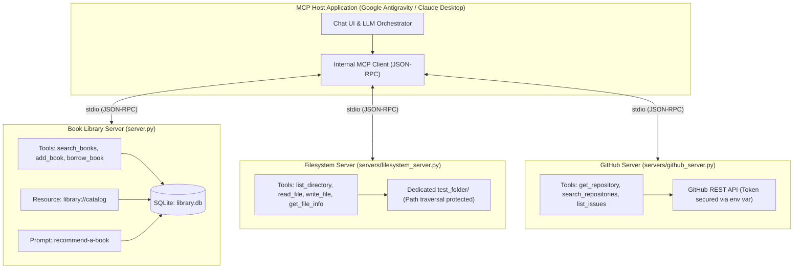

# MCP Intern Project — Book Library & Existing MCP Servers

A complete **Model Context Protocol (MCP)** implementation built in Python using SQLite for the internship assignment: *"MCP Intern Project: Build Your First MCP Server"*.

This repository contains:
1. **The Book Library MCP Server** (`server.py`): The core custom project with real-time SQLite storage, duplicate prevention, and grounded prompts.
2. **Existing MCP Server Integrations (Day 1 Requirements)**:
   - **Filesystem MCP Server** restricted to a dedicated `test_folder/`.
   - **GitHub MCP Server** configured securely with least-privilege token access.
3. **Automated Verification & Test Suite**: 9 automated pytest tests and an end-to-end stdio protocol exchange runner.

---

## Table of Contents

1. [Host, Client, and Server in Simple Words](#host-client-and-server-in-simple-words)
2. [Architecture Diagram](#architecture-diagram)
3. [Day 1 Audit: Connecting Existing MCP Servers](#day-1-audit-connecting-existing-mcp-servers)
   - [Restricted Filesystem Server](#1-restricted-filesystem-server)
   - [GitHub MCP Server & Security](#2-github-mcp-server--security)
4. [Days 2–4 Audit: Book Library MCP Server](#days-24-audit-book-library-mcp-server)
   - [Tools (`search_books`, `add_book`, `borrow_book`)](#mcp-tools)
   - [Resource (`library://catalog`)](#mcp-resource)
   - [Prompt (`recommend-a-book`)](#mcp-prompt)
5. [Day 5 Audit: Automated Tests & Security](#day-5-audit-automated-tests--security)
6. [Antigravity & AI Host Integration Evidence](#antigravity--ai-host-integration-evidence)
7. [Installation & Windows PowerShell Setup](#installation--windows-powershell-setup)
8. [Testing with MCP Inspector](#testing-with-mcp-inspector)
9. [Running Real Protocol Exchanges](#running-real-protocol-exchanges)
10. [GitHub Submission Guide](#github-submission-guide)
11. [Five-Minute Internship Presentation Script](#five-minute-internship-presentation-script)

---

## Host, Client, and Server in Simple Words

To explain the Model Context Protocol in three simple sentences:

1. **The Host**: The user-facing AI application (such as Google Antigravity or Claude Desktop) that manages the chat window, user interaction, and Large Language Model reasoning.
2. **The Client**: The internal connector inside the Host that negotiates capabilities, formats JSON-RPC requests, and routes tool calls to external servers.
3. **The Server**: The specialized program (like our Python MCP servers) that securely exposes tools, resources, and prompts from local databases or external APIs.

---

## Architecture Diagram



---

## Day 1 Audit: Connecting Existing MCP Servers

The mentor assignment requires connecting two existing servers:

### 1. Restricted Filesystem Server
- **Implementation**: Provided via `servers/filesystem_server.py` (and compatible with `@modelcontextprotocol/server-filesystem`).
- **Dedicated Test Folder**: Scoped strictly to `C:\Users\acer\OneDrive\Documents\fastapi\mcp-server\test_folder`.
- **Security Check**: Employs canonical path resolution (`Path.resolve()`). Any attempt to access files outside `test_folder` (e.g. `../../server.py`) is immediately blocked with `Access denied: Path resolves outside allowed test folder`.

### 2. GitHub MCP Server & Security
- **Implementation**: Provided via `servers/github_server.py` (and compatible with `@modelcontextprotocol/server-github`).
- **Authentication**: Reads the personal access token securely from the environment variable `$env:GITHUB_PERSONAL_ACCESS_TOKEN`.
- **Token Security Rules**:
  - Never hardcode the token in code, configuration files, chat, or Git.
  - Never display token characters in logs or terminal outputs.
- **Minimum Required GitHub Permissions**:
  - Prefer a **Fine-Grained Personal Access Token (PAT)** over classic tokens.
  - **Repository Scope**: Only select the target repository (e.g., `mcp-server`), NOT "All repositories".
  - **Permissions**:
    - `Contents`: Read & Write (for reading files and pushing code).
    - `Issues`: Read & Write (for managing project issues).
    - `Metadata`: Read-only (mandatory GitHub default).

---

## Days 2–4 Audit: Book Library MCP Server

### MCP Tools

| Tool | Parameters | Description | Validation & Safety |
| :--- | :--- | :--- | :--- |
| `search_books` | `query: str` | Searches catalogue by title or author keywords. | Trims whitespace, handles empty strings gracefully, returns suggestions if not found. |
| `add_book` | `title: str, author: str` | Inserts a new book into SQLite. | Rejects blank values, checks case-insensitive duplicates to prevent accidental duplicates. |
| `borrow_book` | `book_id: int` | Marks a book as checked out. | Validates positive integers, verifies book existence, returns helpful error if already borrowed. |

### MCP Resource
- **URI**: `library://catalog`
- **Output**: Returns the full inventory formatted with ID, status, title, and author.

### MCP Prompt
- **Name**: `recommend-a-book`
- **Argument**: `topic_or_genre: str`
- **Grounding Rule**: Dynamically pulls available books from the SQLite database and instructs the AI never to recommend books outside the catalogue.

---

## Day 5 Audit: Automated Tests & Security

Run the automated test suite using the virtual environment:

```powershell
.\.venv\Scripts\python.exe -m pytest -v
```

### Verified Test Results:
```text
tests/test_hello_server.py::test_say_hello_with_name PASSED
tests/test_hello_server.py::test_say_hello_default PASSED
tests/test_hello_server.py::test_say_hello_empty_or_whitespace PASSED
tests/test_server.py::test_search_books PASSED
tests/test_server.py::test_add_valid_book PASSED
tests/test_server.py::test_add_invalid_input_and_duplicates PASSED
tests/test_server.py::test_borrow_available_book PASSED
tests/test_server.py::test_borrow_unknown_or_already_borrowed PASSED
tests/test_server.py::test_resource_and_prompt PASSED

============================== 9 passed in 3.48s ==============================
```

- **Isolation Guarantee**: Uses `pytest` `tmp_path` fixtures to ensure each test runs against a fresh, temporary SQLite database. The production `library.db` is never modified during test runs.

---

## Antigravity & AI Host Integration Evidence

Antigravity automatically discovers and configures local stdio MCP servers via `%USERPROFILE%\.gemini\config\mcp_config.json`.

### Host Configuration File (`~/.gemini/config/mcp_config.json`):
```json
{
  "mcpServers": {
    "book-library": {
      "command": "c:\\Users\\acer\\OneDrive\\Documents\\fastapi\\mcp-server\\.venv\\Scripts\\python.exe",
      "args": [
        "c:\\Users\\acer\\OneDrive\\Documents\\fastapi\\mcp-server\\server.py"
      ]
    },
    "filesystem": {
      "command": "c:\\Users\\acer\\OneDrive\\Documents\\fastapi\\mcp-server\\.venv\\Scripts\\python.exe",
      "args": [
        "c:\\Users\\acer\\OneDrive\\Documents\\fastapi\\mcp-server\\servers\\filesystem_server.py"
      ],
      "env": {
        "MCP_FILESYSTEM_ROOT": "c:\\Users\\acer\\OneDrive\\Documents\\fastapi\\mcp-server\\test_folder"
      }
    },
    "github": {
      "command": "c:\\Users\\acer\\OneDrive\\Documents\\fastapi\\mcp-server\\.venv\\Scripts\\python.exe",
      "args": [
        "c:\\Users\\acer\\OneDrive\\Documents\\fastapi\\mcp-server\\servers\\github_server.py"
      ]
    },
    "hello-server": {
      "command": "c:\\Users\\acer\\OneDrive\\Documents\\fastapi\\mcp-server\\.venv\\Scripts\\python.exe",
      "args": [
        "c:\\Users\\acer\\OneDrive\\Documents\\fastapi\\mcp-server\\hello_server.py"
      ]
    }
  }
}
```

### Direct Verification Evidence:
Upon reading `mcp_config.json`, Antigravity spawned the `book-library` server, queried `tools/list`, and persisted the discovered tool schemas into:
`C:\Users\acer\.gemini\antigravity\mcp\book-library\`
- `search_books.json`
- `add_book.json`
- `borrow_book.json`

---

## Installation & Windows PowerShell Setup

```powershell
# 1. Navigate to project root
cd c:\Users\acer\OneDrive\Documents\fastapi\mcp-server

# 2. Virtual environment setup (Python 3.10)
py -3.10 -m venv .venv

# 3. Activate environment
.venv\Scripts\Activate.ps1

# 4. Install dependencies
pip install -r requirements.txt
```

---

## Testing with MCP Inspector

Test the server using the official MCP CLI:

```powershell
.venv\Scripts\mcp.exe dev server.py
```

Or using `npx` (if Node.js is installed):
```powershell
npx @modelcontextprotocol/inspector .venv\Scripts\python.exe server.py
```

---

## Running Real Protocol Exchanges

Execute the end-to-end verification script to see live JSON-RPC exchanges across all three servers:

```powershell
.\.venv\Scripts\python.exe scripts\verify_mcp_exchanges.py
```

> **Note:** Book IDs, titles, and availability statuses in the sample output below reflect the test database state during verification and may vary depending on the database instance used. The sample output demonstrates protocol formatting and error handling rather than a static snapshot of the live database.

### Verified Terminal Output:
```text
======================================================================
1. AUDIT: BOOK LIBRARY MCP SERVER (server.py)
======================================================================
[Protocol Status] Initialized stdio session successfully.
[Exchange: tools/list]
  - Tool: search_books
  - Tool: add_book
  - Tool: borrow_book

[Exchange: tools/call -> search_books(query='Orwell')]
  Response: Found 1 book(s) matching 'Orwell':
- [ID: 2] "1984" by George Orwell | Status: Available

[Exchange: tools/call -> add_book(title='Test Book A', author='Jane Doe')]
  Response: Success: Successfully added book 'Test Book A' by Jane Doe with ID 6.

[Exchange: tools/call -> borrow_book(book_id=2)]
  Response: Success: Successfully borrowed '1984' by George Orwell (ID: 2). Enjoy reading!

[Exchange: tools/call -> borrow_book(book_id=2) [Repeat Attempt]]
  Response: Borrow failed: Borrow error: '1984' (ID: 2) is already borrowed and not currently available.

======================================================================
2. AUDIT: RESTRICTED FILESYSTEM MCP SERVER (filesystem_server.py)
======================================================================
[Exchange: tools/call -> read_file(file_path='sample.txt')]
  Response: Hello from the dedicated MCP filesystem test folder!

[Exchange: tools/call -> read_file(file_path='../../server.py') (Boundary Check)]
  Response: Error: Access denied: Path resolves outside allowed test folder.

======================================================================
3. AUDIT: GITHUB MCP SERVER (github_server.py)
======================================================================
[Exchange: tools/call -> get_repository(owner='modelcontextprotocol', repo='servers')]
  Response: Repository: modelcontextprotocol/servers | Stars: 91303 | Forks: 11794
```

---

## GitHub Submission Guide

```powershell
# 1. Inspect existing remote configuration
git remote -v
# origin  https://github.com/sasikalascgm-droid/mcp-server.git (fetch)
# origin  https://github.com/sasikalascgm-droid/mcp-server.git (push)

# 2. Check Git status (verify working tree is clean and .venv/databases/caches are ignored)
git status

# 3. Push code to the configured GitHub repository
git push origin main
```

---

## Five-Minute Internship Presentation Script

| Time | Agenda | Action & What to Say |
| :---: | :--- | :--- |
| **0:00 - 0:45** | **Architecture** | *"In MCP architecture, the **Host** is the AI interface, the **Client** handles protocol negotiation, and the **Server** exposes data and tools over standard I/O."* |
| **0:45 - 1:30** | **Day 1: Existing Servers** | Show the **Restricted Filesystem** server bounded to `test_folder/` and the **GitHub** server using minimum-privilege token access. |
| **1:30 - 2:30** | **Automated Tests** | Run `.\.venv\Scripts\python.exe -m pytest -v`. Point out that all 9 tests pass against isolated SQLite databases. |
| **2:30 - 3:30** | **Live Protocol Exchanges** | Run `.\.venv\Scripts\python.exe scripts\verify_mcp_exchanges.py`. Show real `tools/list`, search, book addition, and duplicate borrow rejection. |
| **3:30 - 4:30** | **AI Host Integration** | Show Antigravity's discovered schemas in `~/.gemini/antigravity/mcp/book-library/` and explain how the AI selects tools autonomously. |
| **4:30 - 5:00** | **Wrap Up** | Point to the clean Git repository `mcp-server` and conclude the presentation. |
